# Búsqueda de texto completo, vectorial e híbrida en Azure SQL Database

Implement intelligent search with full-text, vector, and hybrid queries

Álvaro García-Quismondo Lizana · 25 de octubre de 2026

## Contenido

- 1. Objetivo y entorno
- 2. Base de datos en Azure
- 3. Proyecto de Foundry y modelo de embeddings
- 4. Identidad administrada y permisos
- 5. Tabla de reseñas
- 6. Credencial y modelo externo
- 7. Columna vectorial, embeddings e índice
- 8. Índice de texto completo
- 9. Búsquedas de texto completo
- 10. Búsquedas vectoriales
- 11. Búsqueda híbrida con RRF
- 12. Comparativa de las tres técnicas
- 13. Resumen de incidencias
- 14. Observaciones
- 15. Scripts incluidos

## 1. Objetivo y entorno

En esta práctica monto tres formas de buscar sobre una misma tabla de reseñas de producto en Azure SQL Database: texto completo, búsqueda vectorial con embeddings y búsqueda híbrida, que mezcla las dos con Reciprocal Rank Fusion (RRF). Al final lanzo la misma pregunta por las tres vías y comparo lo que devuelve cada una.

Trabajo sobre la base de ejemplo AdventureWorksLT, a la que añado una tabla `dbo.ProductReview` con 140 reseñas. Los embeddings los genera el modelo `text-embedding-3-small` de Azure OpenAI, que se llama desde T-SQL con `AI_GENERATE_EMBEDDINGS`.

| Elemento | Valor |
|---|---|
| Suscripción | Azure for Students |
| Grupo de recursos | rg-sqlailab |
| Servidor SQL | rg-sqlailab (Spain Central, solo autenticación Microsoft Entra) |
| Base de datos | AdventureWorksLT, General Purpose serverless |
| Proyecto de Foundry | proj-sqlailab-agql |
| Recurso de Azure OpenAI | proj-sqlailab-agql-resource |
| Modelo de embeddings | text-embedding-3-small, despliegue Estándar global |
| Cliente SQL | SQL Server Management Studio, con Microsoft Entra MFA |

SSMS es lo único que instalé en el portátil. El portal de Azure y el de Foundry se usan desde el navegador.

## 2. Base de datos en Azure

Creé la base desde el portal de Azure con el nombre AdventureWorksLT, un servidor nuevo llamado rg-sqlailab en Spain Central y autenticación solo con Microsoft Entra, con mi cuenta como administradora. La opción de datos de ejemplo hace que se cargue el esquema SalesLT.

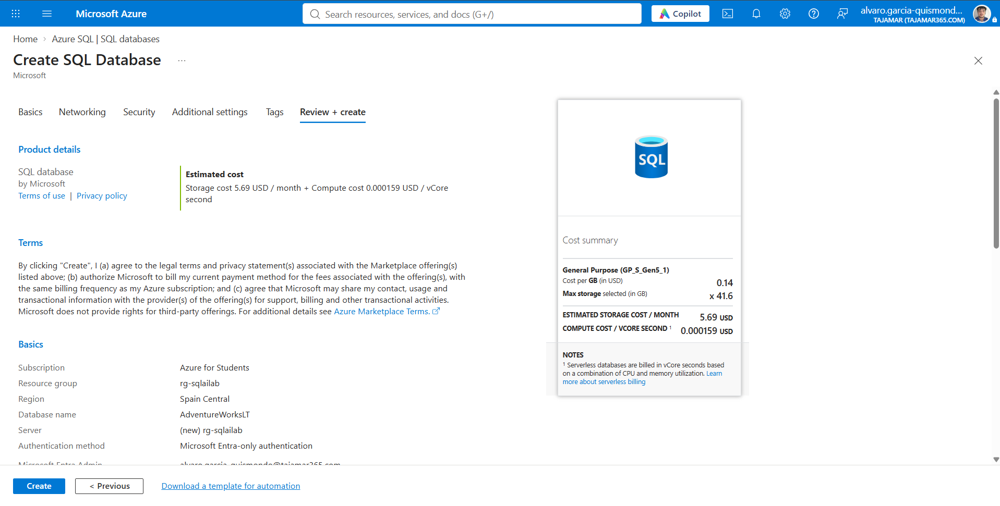

*Figura 1. Pestaña Review + create de la base de datos, con región Spain Central y autenticación solo Microsoft Entra.*

El despliegue terminó sin problemas.

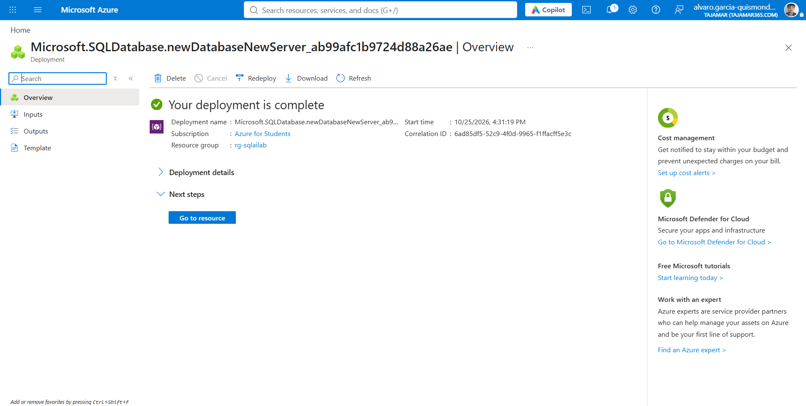

*Figura 2. Despliegue de Azure SQL Database completado.*

## 3. Proyecto de Foundry y modelo de embeddings

### 3.1 Incidencias al crear el proyecto

Crear el proyecto de Foundry me dio dos errores seguidos antes de funcionar.

El primero vino de una política de la suscripción. El asistente me proponía por defecto la región Sweden Central y el grupo de recursos NetworkWatcherRG, y Azure rechazó el recurso por estar fuera de las regiones permitidas. Lo resolví eligiendo Spain Central y el mismo grupo de la base de datos, rg-sqlailab.

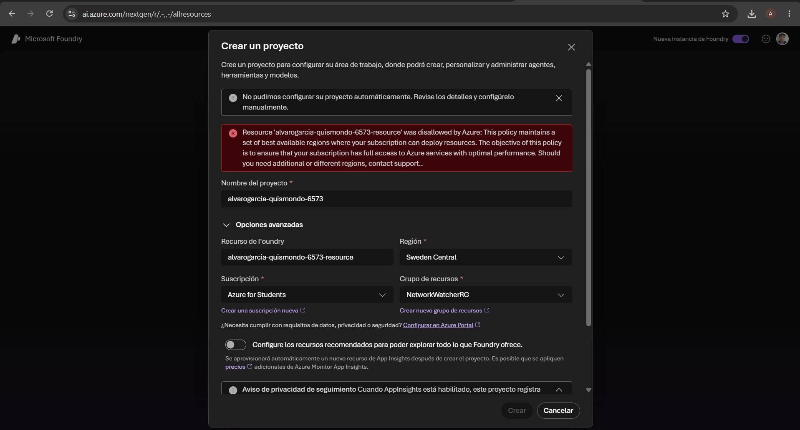

*Figura 3. Error de política de región al crear el proyecto (Sweden Central, NetworkWatcherRG).*

El segundo fue CustomDomainInUse. Con el nombre proj-sqlailab, el subdominio proj-sqlailab-resource ya figuraba como usado. Cambié el nombre del proyecto a proj-sqlailab-agql, de modo que el recurso quedó como proj-sqlailab-agql-resource.

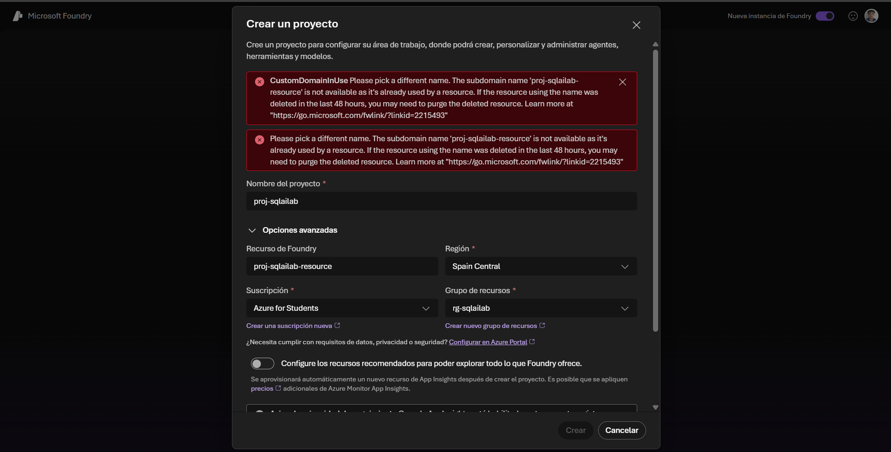

*Figura 4. Error CustomDomainInUse con el nombre proj-sqlailab.*

### 3.2 Modelo de chat no disponible

El enunciado pide desplegar también gpt-5.4-mini. En mi suscripción Azure for Students ese modelo no tiene cuota y el botón de despliegue aparece deshabilitado con el aviso de que no está disponible por falta de cuota.

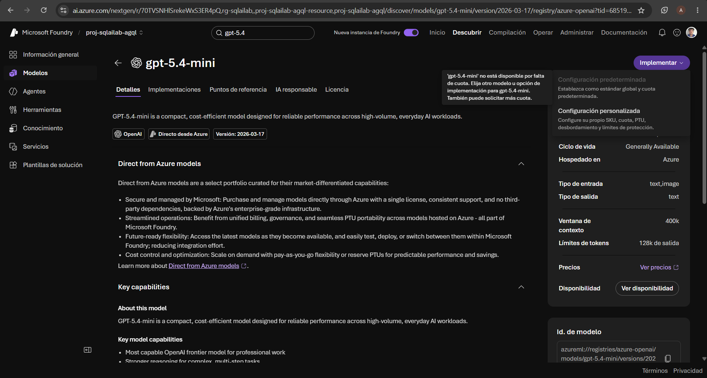

*Figura 5. Ficha de gpt-5.4-mini con el despliegue no disponible por falta de cuota.*

Ninguna consulta de esta práctica usa un modelo de chat, solo el de embeddings, así que seguí sin él. Queda pendiente por si los laboratorios siguientes lo necesitan.

### 3.3 Despliegue de text-embedding-3-small

Desplegué text-embedding-3-small con la configuración por defecto. En la sección de modelos aparece con tipo Estándar global y estado Succeeded.

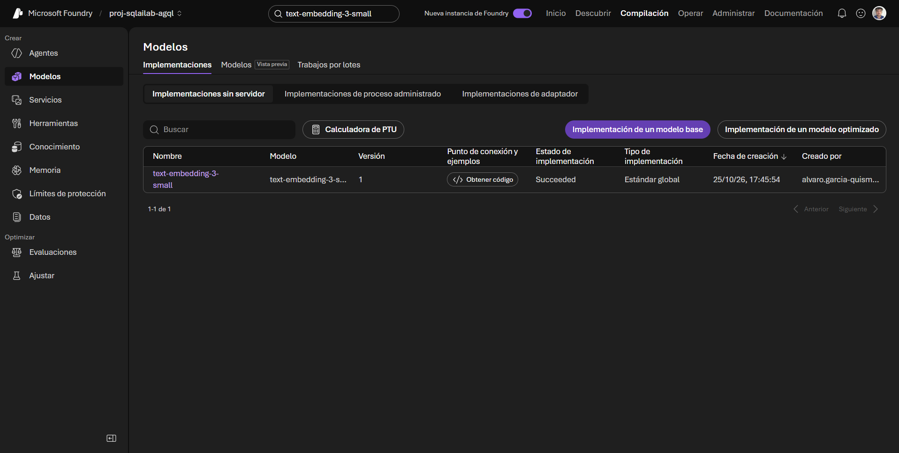

*Figura 6. Despliegue de text-embedding-3-small en Foundry.*

### 3.4 Endpoint de Azure OpenAI

El endpoint que necesita T-SQL está en el portal de Azure, en el recurso proj-sqlailab-agql-resource, apartado Keys and Endpoint, pestaña OpenAI. La pestaña Foundry muestra otra URL (services.ai.azure.com) que no sirve para `CREATE EXTERNAL MODEL`. El endpoint es `https://proj-sqlailab-agql-resource.openai.azure.com/`.

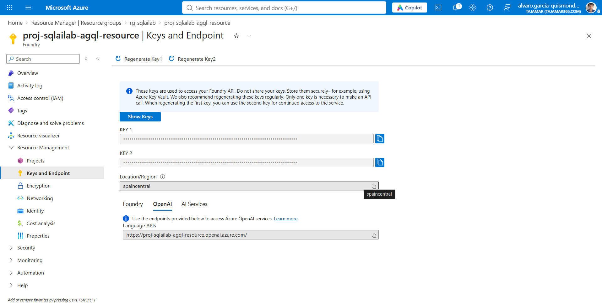

*Figura 7. Keys and Endpoint, pestaña OpenAI, con el endpoint del recurso.*

## 4. Identidad administrada y permisos

Para que el servidor SQL llame a Azure OpenAI sin guardar claves uso su identidad administrada asignada por el sistema. Hay dos pasos. En el servidor rg-sqlailab activé Seguridad, Identidad, estado On, y guardé. Después, en el control de acceso (IAM) del recurso de OpenAI, asigné el rol Cognitive Services OpenAI User a la identidad administrada de ese servidor.

En la lista de asignaciones de roles aparece rg-sqlailab como identidad administrada con el rol Cognitive Services OpenAI User sobre este recurso.

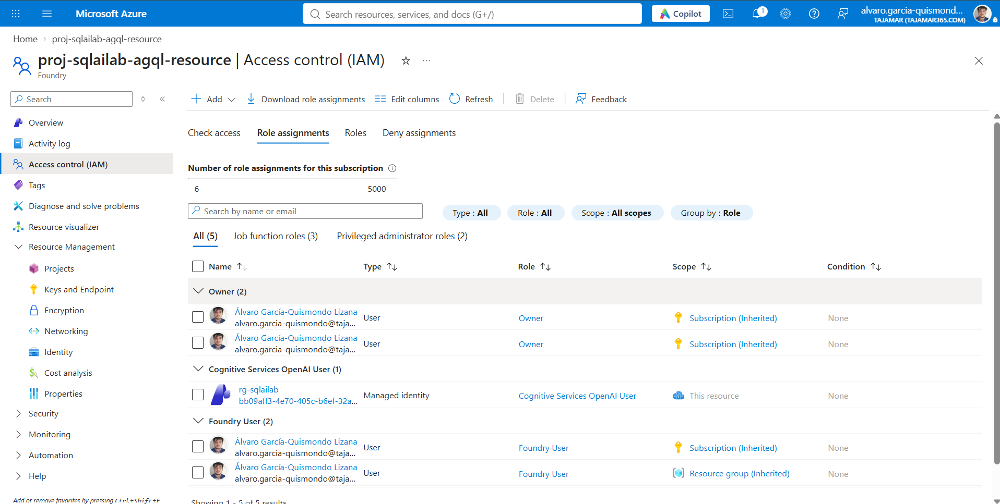

*Figura 8. Asignaciones de roles del recurso de OpenAI, con la identidad del servidor rg-sqlailab y el rol Cognitive Services OpenAI User.*

## 5. Tabla de reseñas

AdventureWorksLT no trae reseñas, así que el laboratorio proporciona un script que crea `dbo.ProductReview` (ReviewID como clave primaria `PK_ProductReview`, ProductID, Rating, ReviewTitle, ReviewText, ReviewDate) e inserta 140 reseñas. Lo guardé como `00-product-reviews-insert.sql`, lo ejecuté entero y comprobé el número de filas.

```sql
SELECT COUNT(*) AS TotalReviews FROM dbo.ProductReview;
GO
```

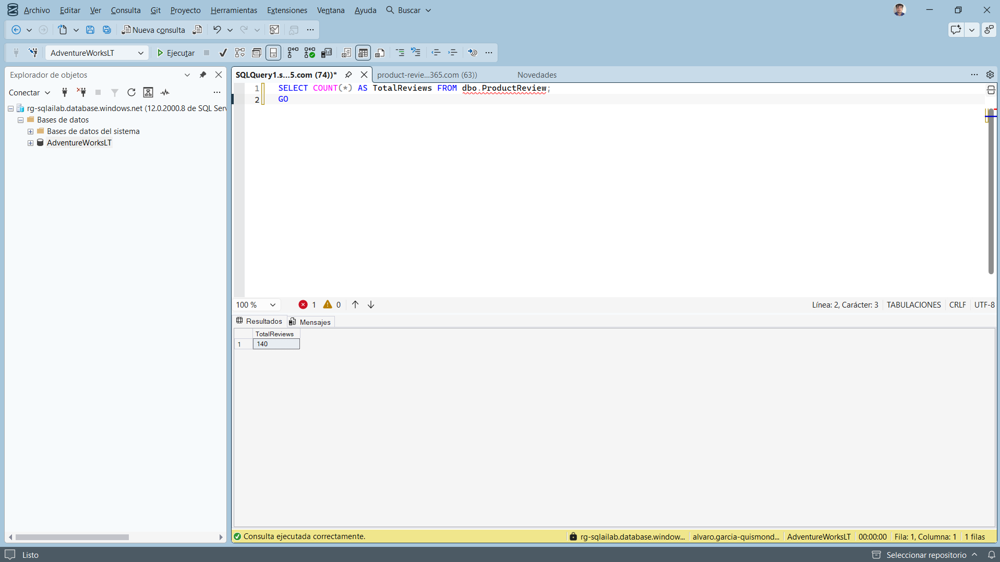

*Figura 9. La tabla contiene 140 reseñas.*

## 6. Credencial y modelo externo

Para llamar a Azure OpenAI desde T-SQL hacen falta tres objetos: la clave maestra de la base de datos, una credencial con identidad administrada y un modelo externo que apunta al despliegue de embeddings. El campo `resourceid` de la credencial tiene que ser exactamente `https://cognitiveservices.azure.com`, que es la audiencia OAuth de los servicios cognitivos, y no la URL de mi recurso.

```sql
IF NOT EXISTS (SELECT * FROM sys.symmetric_keys WHERE name = '##MS_DatabaseMasterKey##')
    CREATE MASTER KEY ENCRYPTION BY PASSWORD = '<contrasena-compleja>';
GO

CREATE DATABASE SCOPED CREDENTIAL [https://proj-sqlailab-agql-resource.openai.azure.com]
WITH IDENTITY = 'Managed Identity', SECRET = '{"resourceid":"https://cognitiveservices.azure.com"}';
GO

CREATE EXTERNAL MODEL my_embedding_model
WITH (
    LOCATION = 'https://proj-sqlailab-agql-resource.openai.azure.com/openai/deployments/text-embedding-3-small/embeddings?api-version=2024-10-21',
    API_FORMAT = 'Azure OpenAI',
    MODEL_TYPE = EMBEDDINGS,
    MODEL = 'text-embedding-3-small',
    CREDENTIAL = [https://proj-sqlailab-agql-resource.openai.azure.com]
);
GO
```

En el script de la memoria la contraseña de la clave maestra es un marcador, porque la real no debe quedar en un documento.

### 6.1 Incidencias con la clave maestra

Mi primera ejecución falló. Había dejado el texto de ejemplo de la contraseña sin sustituir y la última línea quedó como `G` en vez de `GO`. La clave maestra no se creó (error 40632, la contraseña no cumple la política de complejidad) y por eso la credencial y el modelo fallaron en cascada con los errores 15581 (falta la clave maestra) y 46516 (credencial no encontrada).

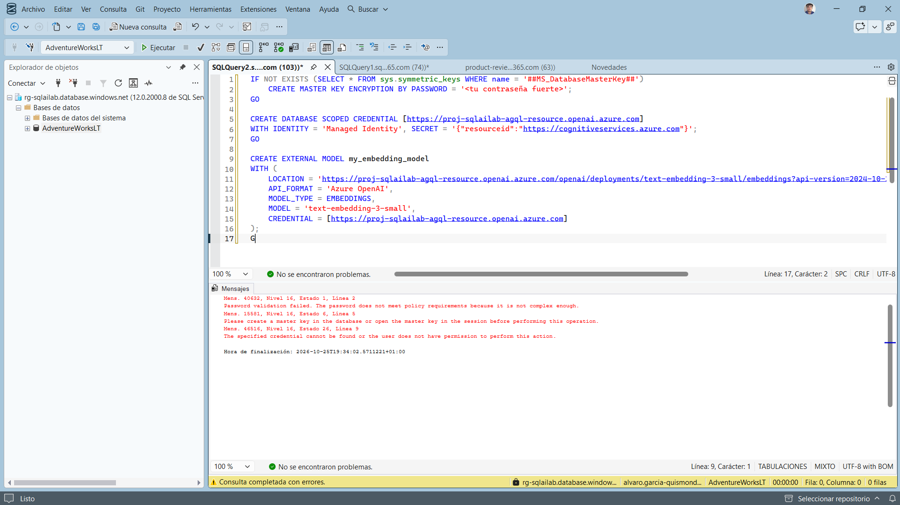

*Figura 10. Errores 40632, 15581 y 46516 en la primera ejecución.*

Lo corregí con una contraseña que cumple la política (mayúsculas, minúsculas, números y símbolo) y con `GO` en la última línea. Al lanzar otra vez el bloque completo apareció el error 15530, porque la credencial ya existía de la ejecución anterior. No hacía falta repetir nada: bastaba comprobar qué objetos había.

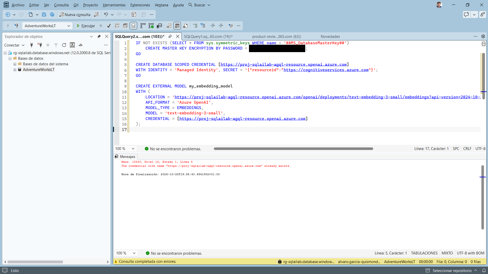

*Figura 11. Error 15530, la credencial ya existe. La contraseña del laboratorio está tapada.*

```sql
-- 02. Comprobar que existen la clave maestra, la credencial y el modelo externo
SELECT 'Master key' AS Objeto, name AS Nombre FROM sys.symmetric_keys WHERE name = '##MS_DatabaseMasterKey##'
UNION ALL
SELECT 'Credencial', name FROM sys.database_scoped_credentials
UNION ALL
SELECT 'Modelo externo', name FROM sys.external_models;
GO
```

La consulta devuelve las tres filas esperadas: la clave maestra, la credencial y el modelo `my_embedding_model`.

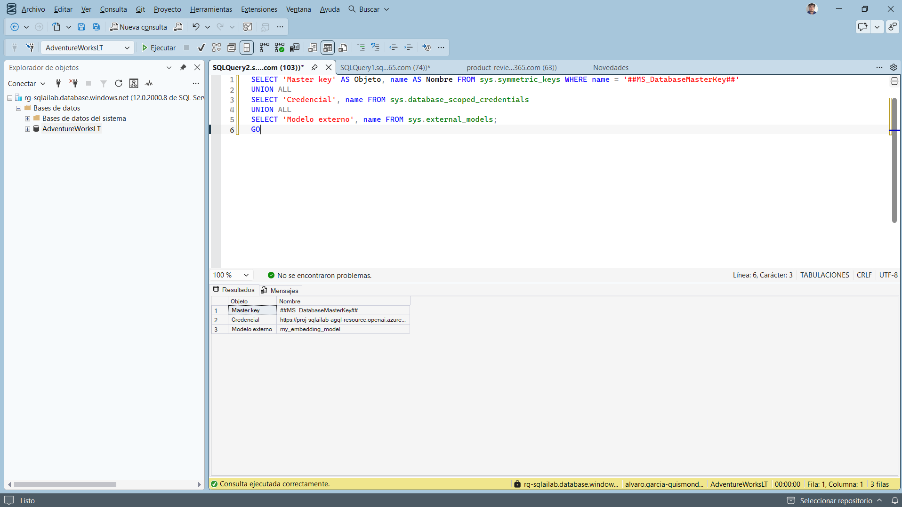

*Figura 12. Clave maestra, credencial y modelo externo creados.*

## 7. Columna vectorial, embeddings e índice

### 7.1 Columna VECTOR(1536)

`text-embedding-3-small` devuelve vectores de 1536 dimensiones, así que añado esa columna a la tabla.

```sql
ALTER TABLE dbo.ProductReview
ADD ReviewVector VECTOR(1536);
GO
```

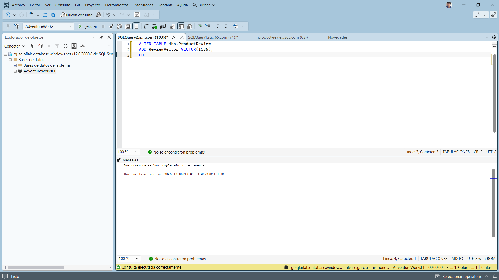

*Figura 13. Columna ReviewVector añadida a dbo.ProductReview.*

### 7.2 Generación de embeddings

Cada embedding se calcula sobre el texto compuesto por el nombre del producto, el título y el cuerpo de la reseña. El script procesa 30 reseñas por lote, espera 2 segundos entre lotes y reintenta hasta tres veces si la API limita el ritmo.

```sql
DECLARE @batchSize INT = 30;
DECLARE @rowsUpdated INT = 1;
DECLARE @retryCount INT;
DECLARE @maxRetries INT = 3;

WHILE @rowsUpdated > 0
BEGIN
    SET @retryCount = 0;

    RETRY:
    BEGIN TRY
        UPDATE TOP (@batchSize) r
        SET r.ReviewVector = AI_GENERATE_EMBEDDINGS(
            p.Name + ' - ' + r.ReviewTitle + ': ' + r.ReviewText
            USE MODEL my_embedding_model)
        FROM dbo.ProductReview r
        INNER JOIN SalesLT.Product p ON r.ProductID = p.ProductID
        WHERE r.ReviewVector IS NULL;

        SET @rowsUpdated = @@ROWCOUNT;

        IF @rowsUpdated > 0
            WAITFOR DELAY '00:00:02';
    END TRY
    BEGIN CATCH
        SET @retryCount += 1;
        IF @retryCount <= @maxRetries
        BEGIN
            PRINT 'Rate limited. Retrying in 5 seconds... (Attempt '
                + CAST(@retryCount AS NVARCHAR(10)) + ' of '
                + CAST(@maxRetries AS NVARCHAR(10)) + ')';
            WAITFOR DELAY '00:00:05';
            GOTO RETRY;
        END
        ELSE
            THROW;
    END CATCH
END
GO
```

Salieron cinco lotes (30, 30, 30, 30 y 20 filas) y el conjunto tardó 57 segundos.

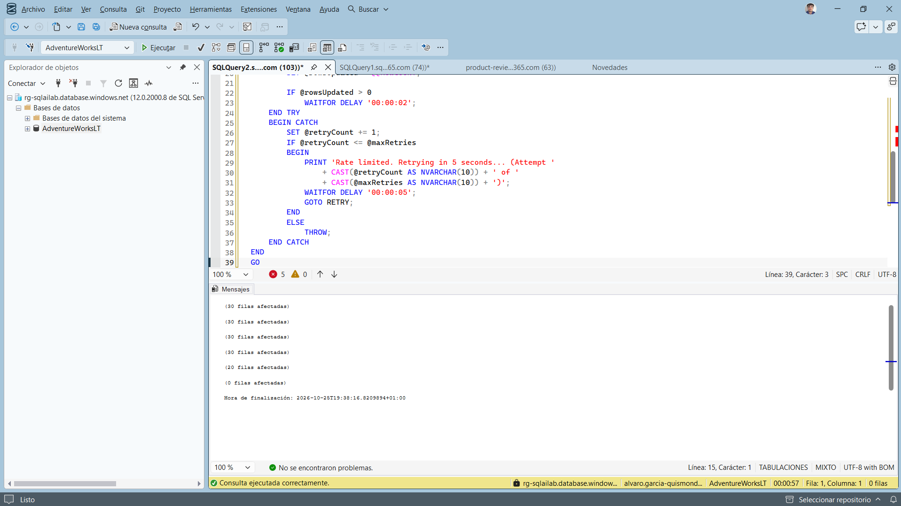

*Figura 14. Lotes de embeddings: cuatro de 30 filas y uno de 20.*

```sql
SELECT
    COUNT(*) AS TotalReviews,
    COUNT(ReviewVector) AS ReviewsWithEmbeddings
FROM dbo.ProductReview;
GO
```

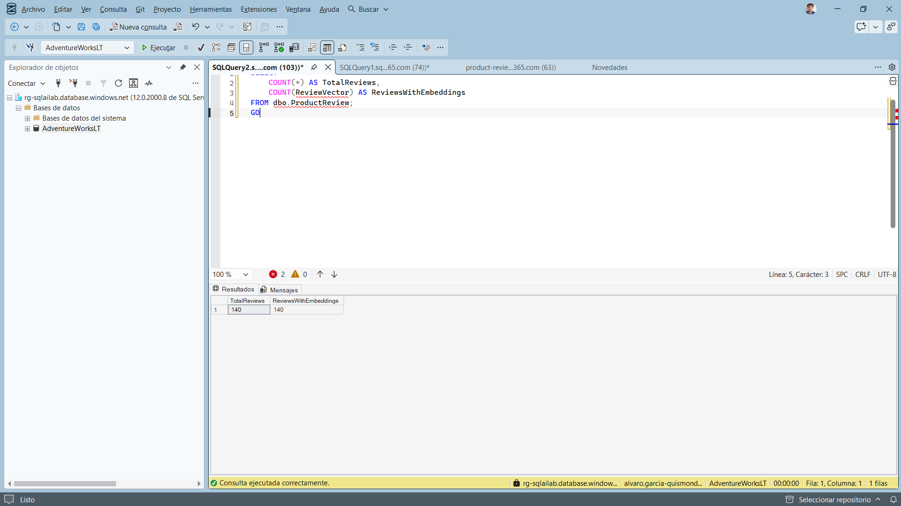

*Figura 15. Las 140 reseñas tienen embedding.*

### 7.3 Índice vectorial DiskANN

Antes de crear el índice activo las funciones en vista previa. `ALLOW_STALE_VECTOR_INDEX` evita que la tabla pase a solo lectura al existir el índice. El índice usa distancia coseno.

```sql
ALTER DATABASE SCOPED CONFIGURATION SET PREVIEW_FEATURES = ON;
GO

ALTER DATABASE SCOPED CONFIGURATION SET ALLOW_STALE_VECTOR_INDEX = ON;
GO

CREATE VECTOR INDEX IX_Review_ReviewVector
ON dbo.ProductReview(ReviewVector)
WITH (METRIC = 'cosine', TYPE = 'DISKANN');
GO
```

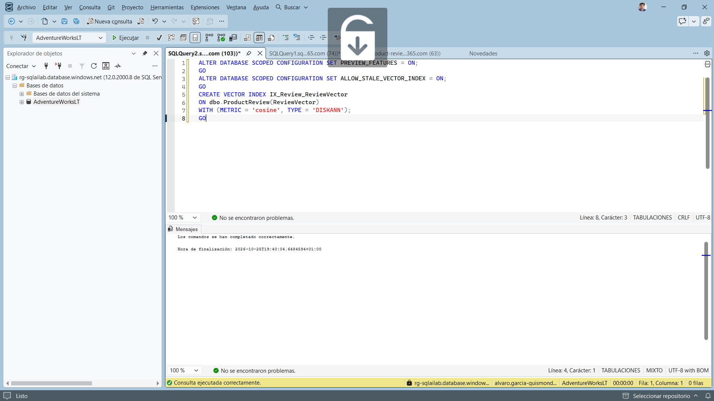

*Figura 16. Índice IX_Review_ReviewVector creado.*

## 8. Índice de texto completo

Creo un catálogo de texto completo como predeterminado y un índice sobre ReviewTitle y ReviewText en inglés (idioma 1033), apoyado en la clave primaria. Con `CHANGE_TRACKING AUTO` el índice se mantiene al día solo.

```sql
CREATE FULLTEXT CATALOG ProductReviewCatalog AS DEFAULT;
GO

CREATE FULLTEXT INDEX ON dbo.ProductReview
(
    ReviewTitle LANGUAGE 1033,
    ReviewText LANGUAGE 1033
)
KEY INDEX PK_ProductReview
ON ProductReviewCatalog
WITH (CHANGE_TRACKING AUTO);
GO
```

La primera lectura del estado devolvió PopulateStatus 1, es decir, el índice aún se estaba poblando. Repetí la consulta unos segundos después y salió 0, con HasActiveIndex en 1.

```sql
-- PopulateStatus debe llegar a 0 (si vale 1, esperar y repetir)
SELECT
    OBJECTPROPERTY(OBJECT_ID('dbo.ProductReview'), 'TableFullTextPopulateStatus') AS PopulateStatus,
    OBJECTPROPERTY(OBJECT_ID('dbo.ProductReview'), 'TableHasActiveFulltextIndex') AS HasActiveIndex;
GO
```

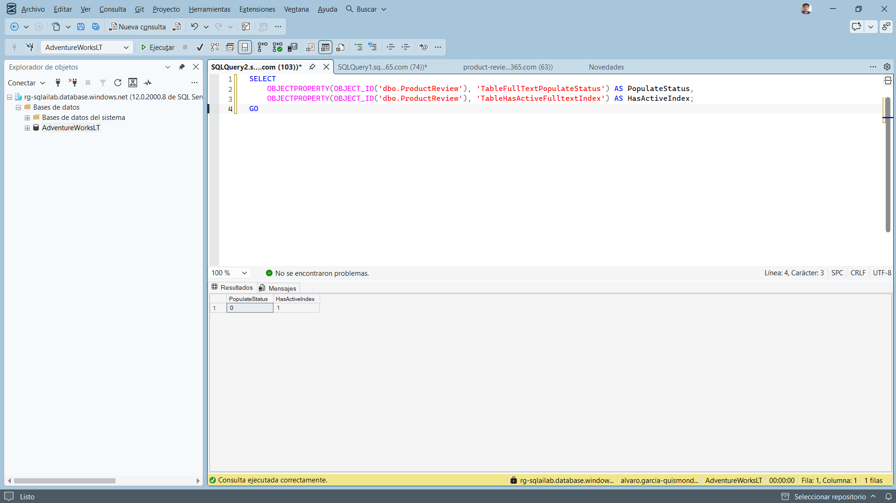

*Figura 17. Índice de texto completo poblado (PopulateStatus 0) y activo.*

## 9. Búsquedas de texto completo

### 9.1 CONTAINS

`CONTAINS` busca la palabra exacta. Con `puncture` devuelve 3 reseñas: las dos de pinchazos y la de «Saved me 30 miles from anywhere».

```sql
-- CONTAINS: palabra exacta
SELECT r.ReviewTitle, r.ReviewText, r.Rating, p.Name AS ProductName
FROM dbo.ProductReview r
INNER JOIN SalesLT.Product p ON r.ProductID = p.ProductID
WHERE CONTAINS(r.ReviewText, 'puncture');
GO
```

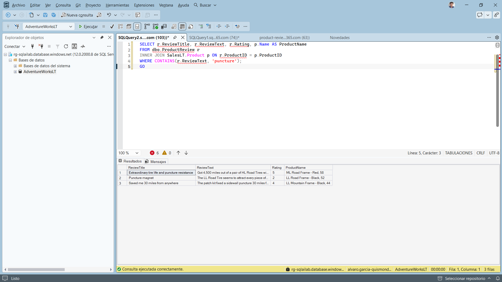

*Figura 18. CONTAINS con la palabra puncture: 3 filas.*

### 9.2 FREETEXT

`FREETEXT` trata la frase como significado y tiene en cuenta las formas flexionadas de cada palabra, además de descartar palabras vacías. La frase `warm gloves for cold winter commuting` devuelve 10 filas con el límite de `TOP 10`.

```sql
-- FREETEXT: frase con formas flexionadas
SELECT TOP 10 r.ReviewTitle, r.ReviewText, r.Rating, p.Name AS ProductName
FROM dbo.ProductReview r
INNER JOIN SalesLT.Product p ON r.ProductID = p.ProductID
WHERE FREETEXT(r.ReviewText, 'warm gloves for cold winter commuting');
GO
```

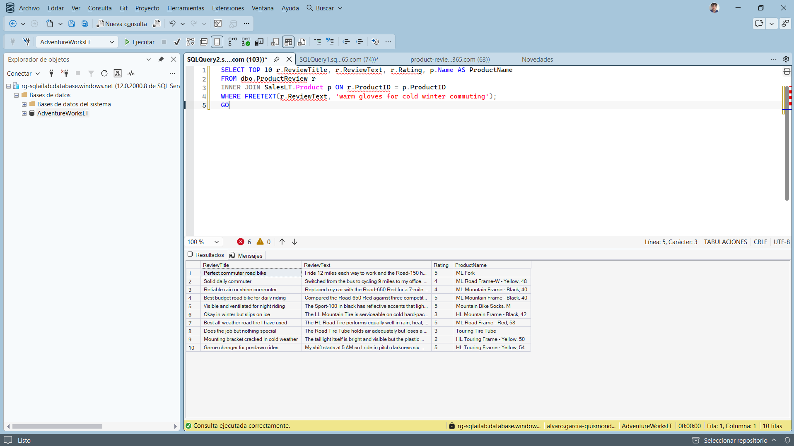

*Figura 19. FREETEXT con una frase sobre guantes de invierno: 10 filas.*

### 9.3 CONTAINSTABLE

`CONTAINSTABLE` devuelve además la columna RANK con la puntuación de cada fila. Con `FORMSOF(INFLECTIONAL, ...)` busco mountain y trail a la vez. Los dos primeros resultados tienen puntuación 21 y el resto 10.

```sql
-- CONTAINSTABLE: resultados con puntuación
SELECT TOP 10
    r.ReviewTitle, r.ReviewText, r.Rating, p.Name AS ProductName,
    ft.[RANK] AS FullTextRank
FROM dbo.ProductReview r
INNER JOIN SalesLT.Product p ON r.ProductID = p.ProductID
INNER JOIN CONTAINSTABLE(dbo.ProductReview, (ReviewTitle, ReviewText),
    'FORMSOF(INFLECTIONAL, mountain) AND FORMSOF(INFLECTIONAL, trail)') AS ft
    ON r.ReviewID = ft.[KEY]
ORDER BY ft.[RANK] DESC;
GO
```

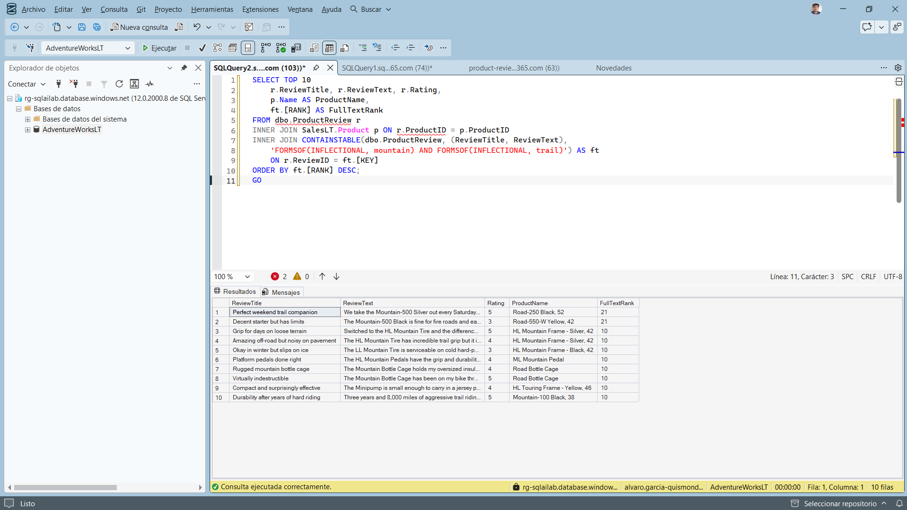

*Figura 20. CONTAINSTABLE con puntuación: 10 filas, las dos primeras con rango 21.*

### 9.4 Prefijo

Con `"comfort*"` coinciden todas las palabras que empiezan por comfort (comfortable, comfortably, etc.). Devuelve 13 filas.

```sql
-- Búsqueda por prefijo
SELECT r.ReviewTitle, r.ReviewText, r.Rating, p.Name AS ProductName
FROM dbo.ProductReview r
INNER JOIN SalesLT.Product p ON r.ProductID = p.ProductID
WHERE CONTAINS(r.ReviewText, '"comfort*"');
GO
```

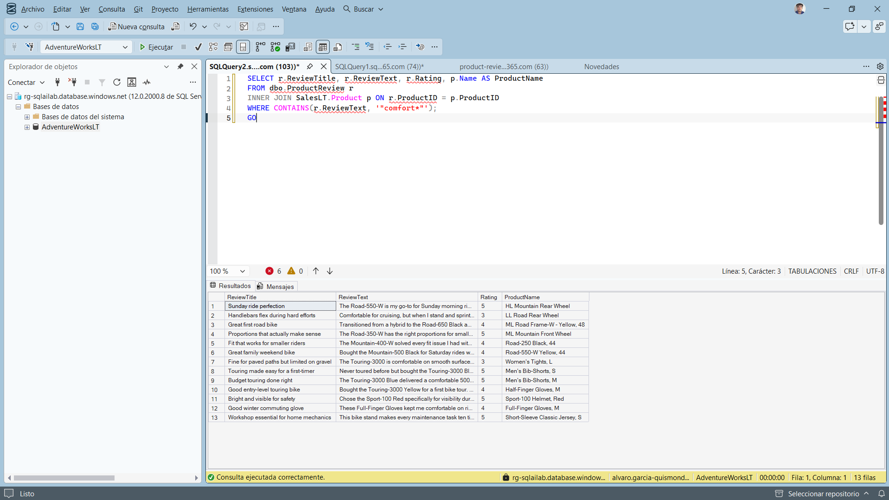

*Figura 21. Búsqueda por prefijo comfort*: 13 filas.*

## 10. Búsquedas vectoriales

### 10.1 Búsqueda exacta con VECTOR_DISTANCE

`VECTOR_DISTANCE` calcula la distancia coseno entre el vector de la pregunta y el de cada reseña, recorriendo la tabla entera. Con 140 filas es instantáneo. Cuanto menor es la distancia, más parecida es la reseña. La mejor distancia fue 0,4494 para «Capable mid-range touring platform».

```sql
-- Búsqueda exacta con VECTOR_DISTANCE
DECLARE @searchText NVARCHAR(1000) = 'comfortable seat for long distance touring';
DECLARE @searchVector VECTOR(1536);
SELECT @searchVector = AI_GENERATE_EMBEDDINGS(@searchText USE MODEL my_embedding_model);

SELECT TOP 5
    p.Name AS ProductName, r.ReviewTitle, r.ReviewText, r.Rating,
    VECTOR_DISTANCE('cosine', @searchVector, r.ReviewVector) AS Distance
FROM dbo.ProductReview r
INNER JOIN SalesLT.Product p ON r.ProductID = p.ProductID
ORDER BY Distance;
GO
```

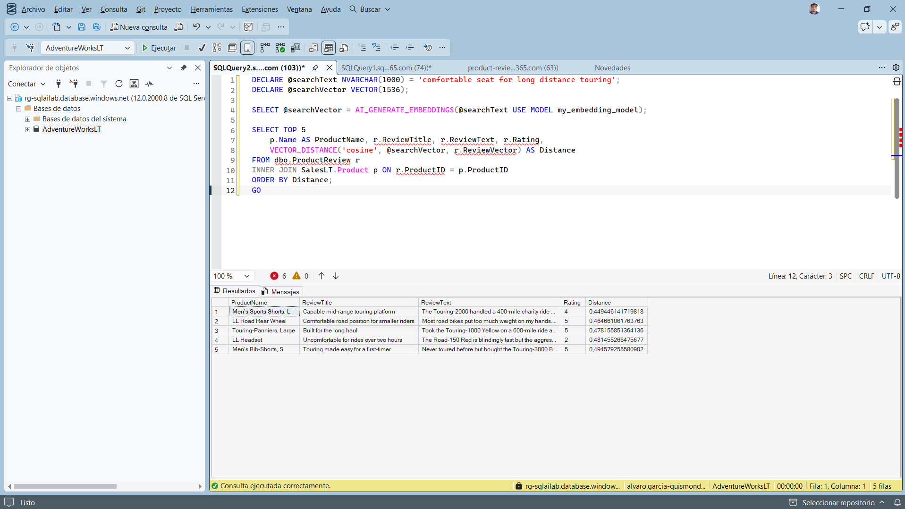

*Figura 22. Búsqueda exacta para comfortable seat for long distance touring, mejor distancia 0,4494.*

### 10.2 Búsqueda aproximada con VECTOR_SEARCH

`VECTOR_SEARCH` usa el índice DiskANN y no recorre toda la tabla. La consulta describe un concepto, algo que me haga visible al montar de noche, sin las palabras exactas de las reseñas.

Aquí tuve un fallo que se repitió en otras tres consultas. Siguiendo el enunciado usé el parámetro `TOP_N = 5` dentro de `VECTOR_SEARCH` y SQL Server devolvió el error 42274: con la versión nueva del índice vectorial ese parámetro no se admite y hay que pedir `SELECT TOP (N) WITH APPROXIMATE`.

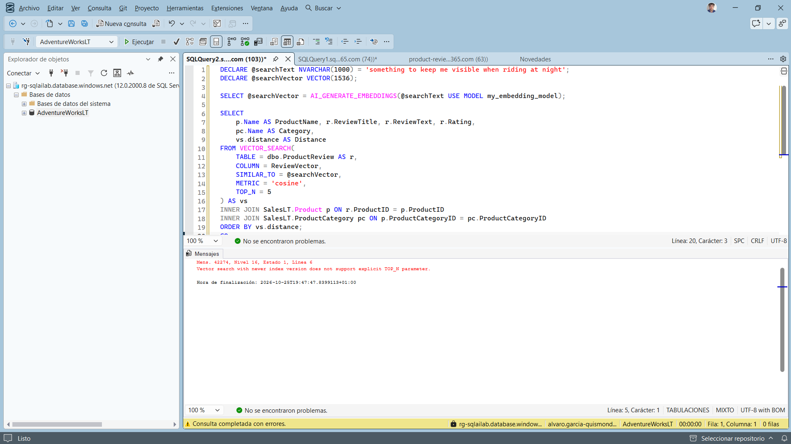

*Figura 23. Error 42274 al usar TOP_N en VECTOR_SEARCH.*

Esta es la versión corregida, que devuelve 5 filas con distancias entre 0,4117 y 0,4912. Los resultados hablan de visibilidad, luces traseras y reflectantes aunque la pregunta no use esas palabras.

```sql
-- Búsqueda aproximada con VECTOR_SEARCH (índice DiskANN)
DECLARE @searchText NVARCHAR(1000) = 'something to keep me visible when riding at night';
DECLARE @searchVector VECTOR(1536);
SELECT @searchVector = AI_GENERATE_EMBEDDINGS(@searchText USE MODEL my_embedding_model);

SELECT TOP (5) WITH APPROXIMATE
    p.Name AS ProductName, r.ReviewTitle, r.ReviewText, r.Rating,
    pc.Name AS Category, vs.distance AS Distance
FROM VECTOR_SEARCH(
    TABLE = dbo.ProductReview AS r,
    COLUMN = ReviewVector,
    SIMILAR_TO = @searchVector,
    METRIC = 'cosine'
) AS vs
INNER JOIN SalesLT.Product p ON r.ProductID = p.ProductID
INNER JOIN SalesLT.ProductCategory pc ON p.ProductCategoryID = pc.ProductCategoryID
ORDER BY vs.distance;
GO
```

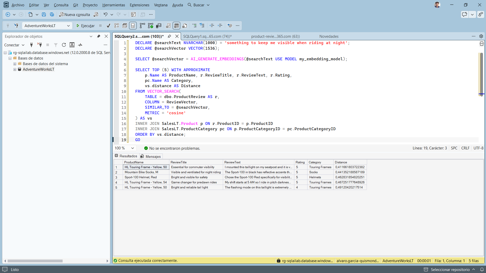

*Figura 24. VECTOR_SEARCH corregido con TOP (5) WITH APPROXIMATE.*

### 10.3 Metadatos del vector

`VECTORPROPERTY` confirma que la columna guarda 1536 dimensiones de tipo float32.

```sql
-- Metadatos del vector
SELECT TOP 1
    VECTORPROPERTY(ReviewVector, 'Dimensions') AS VectorDimensions,
    VECTORPROPERTY(ReviewVector, 'BaseType') AS VectorBaseType
FROM dbo.ProductReview
WHERE ReviewVector IS NOT NULL;
GO
```

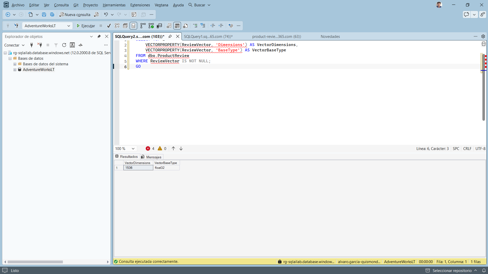

*Figura 25. Dimensiones y tipo base de la columna vectorial.*

## 11. Búsqueda híbrida con RRF

La búsqueda de texto completo falla cuando la reseña dice lo mismo con otras palabras, y la vectorial puede pasar por alto un término concreto de la pregunta. La híbrida lanza las dos y combina las posiciones con Reciprocal Rank Fusion: cada fila suma 1 / (k + posición) por cada lista en la que aparece, con k = 60. Las filas presentes en las dos listas suben.

En la consulta, `keyword_search` toma las 50 mejores de `FREETEXTTABLE`, `vector_search` las 50 más cercanas de `VECTOR_SEARCH` y `combined` las une con un `FULL OUTER JOIN` y calcula la puntuación RRF. Una fila que solo aparece en una lista tiene NULL en el rango de la otra.

Esta consulta también falló con el error 42274 por el mismo motivo. Tuve que cambiar `TOP_N = 50` por `TOP (50) WITH APPROXIMATE` con su `ORDER BY`.

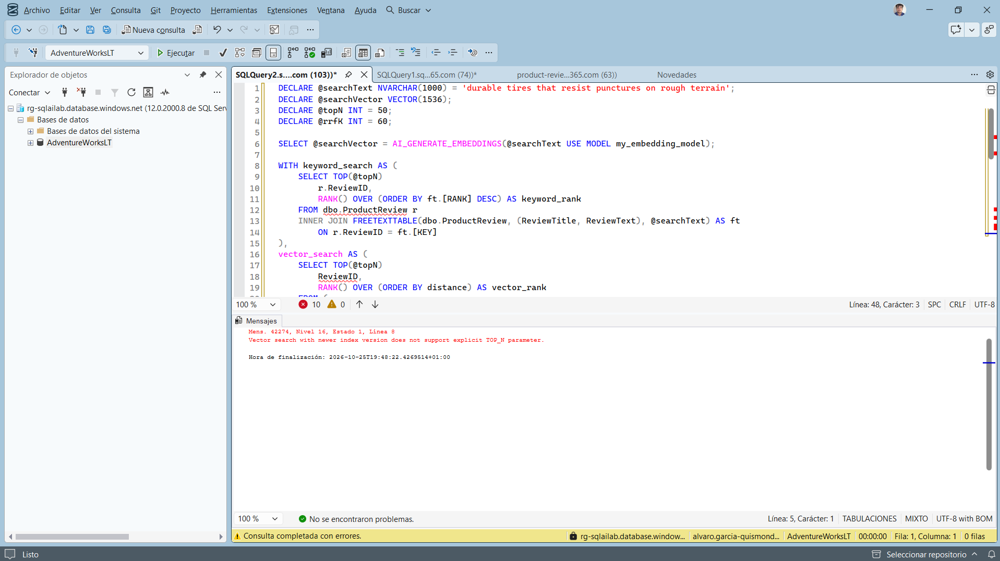

*Figura 26. Error 42274 en la consulta híbrida con TOP_N.*

```sql
DECLARE @searchText NVARCHAR(1000) = 'durable tires that resist punctures on rough terrain';
DECLARE @searchVector VECTOR(1536);
DECLARE @topN INT = 50;
DECLARE @rrfK INT = 60;

SELECT @searchVector = AI_GENERATE_EMBEDDINGS(@searchText USE MODEL my_embedding_model);

WITH keyword_search AS (
    SELECT TOP(@topN)
        r.ReviewID,
        RANK() OVER (ORDER BY ft.[RANK] DESC) AS keyword_rank
    FROM dbo.ProductReview r
    INNER JOIN FREETEXTTABLE(dbo.ProductReview, (ReviewTitle, ReviewText), @searchText) AS ft
        ON r.ReviewID = ft.[KEY]
),
vector_search AS (
    SELECT ReviewID, RANK() OVER (ORDER BY distance) AS vector_rank
    FROM (
        SELECT TOP (50) WITH APPROXIMATE r.ReviewID, vs.distance
        FROM VECTOR_SEARCH(
            TABLE = dbo.ProductReview AS r,
            COLUMN = ReviewVector,
            SIMILAR_TO = @searchVector,
            METRIC = 'cosine'
        ) AS vs
        ORDER BY vs.distance
    ) AS similar_reviews
),
combined AS (
    SELECT
        COALESCE(ks.ReviewID, vs.ReviewID) AS ReviewID,
        ks.keyword_rank,
        vs.vector_rank,
        COALESCE(1.0 / (@rrfK + ks.keyword_rank), 0.0) +
        COALESCE(1.0 / (@rrfK + vs.vector_rank), 0.0) AS rrf_score
    FROM keyword_search ks
    FULL OUTER JOIN vector_search vs ON ks.ReviewID = vs.ReviewID
)
SELECT TOP 10
    p.Name AS ProductName, r.ReviewTitle, r.ReviewText, r.Rating,
    c.keyword_rank, c.vector_rank, c.rrf_score
FROM combined c
INNER JOIN dbo.ProductReview r ON c.ReviewID = r.ReviewID
INNER JOIN SalesLT.Product p ON r.ProductID = p.ProductID
ORDER BY c.rrf_score DESC;
GO
```

Con la pregunta durable tires that resist punctures on rough terrain, la primera fila es «Extraordinary tire life and puncture resistance», con rango 1 en texto completo y 3 en vectorial, y una puntuación RRF de 0,0322664. En estos diez resultados todas las filas aparecen en las dos listas.

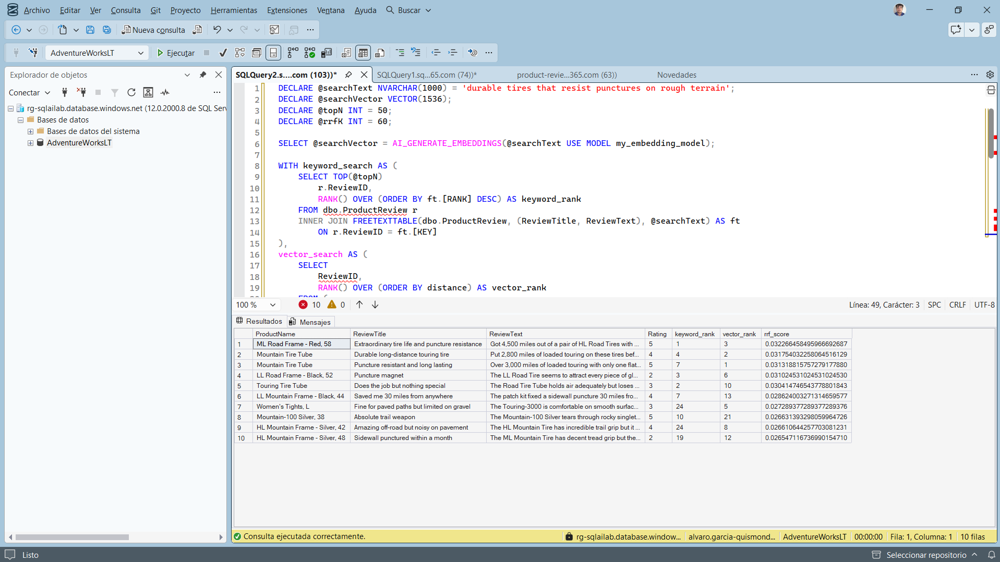

*Figura 27. Búsqueda híbrida corregida: 10 filas con rango de texto, rango vectorial y puntuación RRF.*

## 12. Comparativa de las tres técnicas

Para la comparativa uso la pregunta comfortable bike for long weekend rides with the family con cada técnica, en top 5. Los tres scripts están en `08-comparativa.sql`.

### 12.1 Solo texto completo

`FREETEXTTABLE` devuelve primero las reseñas de la botella de agua («Stays cold for hours on long rides» y «Perfect family hydration solution», puntuación 108) y la de las camisetas («Matching jerseys for the whole family», 92). Coinciden por las palabras long y family, aunque no hablan de una bicicleta cómoda. Después aparecen «Great family weekend bike» (88) y «Great first road bike» (76).

```sql
-- Solo texto completo
SELECT TOP 5
    p.Name AS ProductName, r.ReviewTitle, r.ReviewText, r.Rating,
    ft.[RANK] AS FullTextRank
FROM dbo.ProductReview r
INNER JOIN SalesLT.Product p ON r.ProductID = p.ProductID
INNER JOIN FREETEXTTABLE(dbo.ProductReview, (ReviewTitle, ReviewText),
    'comfortable bike for long weekend rides with the family') AS ft
    ON r.ReviewID = ft.[KEY]
ORDER BY ft.[RANK] DESC;
GO
```

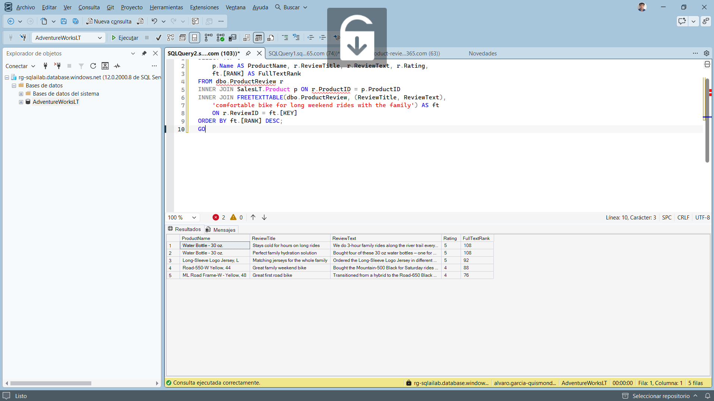

*Figura 28. Solo texto completo: primeras puntuaciones 108, 108, 92, 88 y 76.*

### 12.2 Solo vectorial

La búsqueda vectorial prioriza reseñas de bicicletas para paseo: «Great family weekend bike» (0,3498), «Perfect weekend trail companion» y «Sunday ride perfection». Aquí también salió el error 42274 con `TOP_N`, que corregí igual que antes.

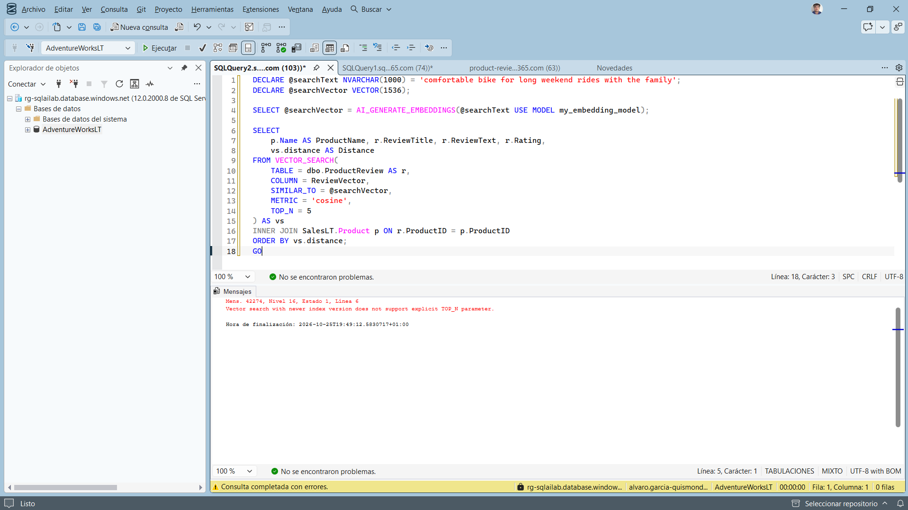

*Figura 29. Error 42274 en la consulta vectorial de la comparativa.*

```sql
-- Solo vectorial
DECLARE @searchText NVARCHAR(1000) = 'comfortable bike for long weekend rides with the family';
DECLARE @searchVector VECTOR(1536);
SELECT @searchVector = AI_GENERATE_EMBEDDINGS(@searchText USE MODEL my_embedding_model);

SELECT TOP (5) WITH APPROXIMATE
    p.Name AS ProductName, r.ReviewTitle, r.ReviewText, r.Rating,
    vs.distance AS Distance
FROM VECTOR_SEARCH(
    TABLE = dbo.ProductReview AS r,
    COLUMN = ReviewVector,
    SIMILAR_TO = @searchVector,
    METRIC = 'cosine'
) AS vs
INNER JOIN SalesLT.Product p ON r.ProductID = p.ProductID
ORDER BY vs.distance;
GO
```

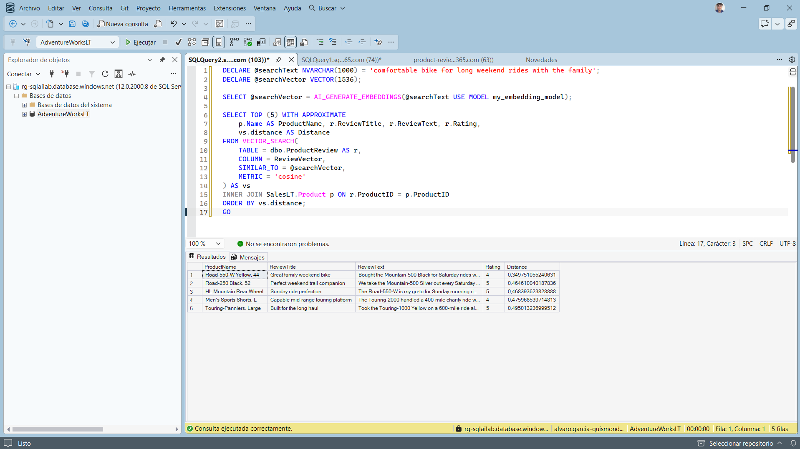

*Figura 30. Solo vectorial: mejor distancia 0,3498.*

### 12.3 Híbrida

La consulta híbrida de la comparativa dio el mismo error, que corregí igualmente.

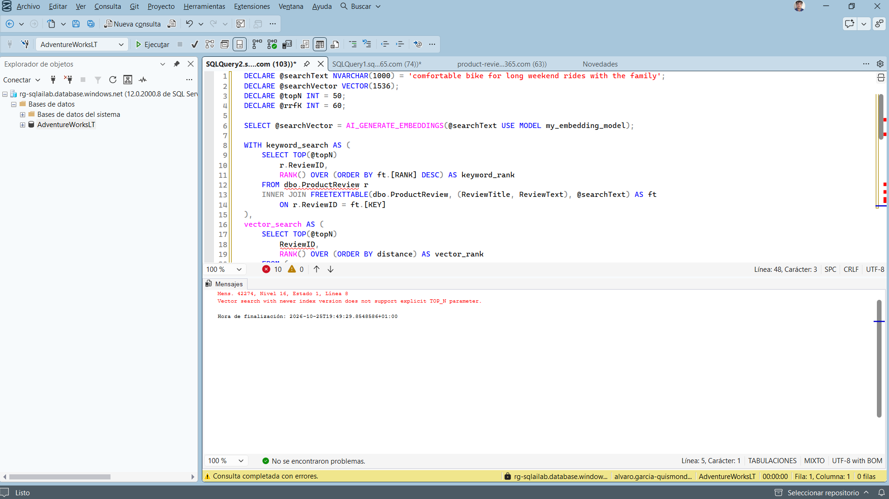

*Figura 31. Error 42274 en la consulta híbrida de la comparativa.*

Resultado: «Great family weekend bike» queda primera, con rango 4 en texto completo y 1 en vectorial (RRF 0,0320184). «Stays cold for hours on long rides» baja a segundo puesto (rango 1 en texto y 7 en vectorial) y «Perfect weekend trail companion», que en texto completo era la 21, sube al quinto por su rango 2 en vectorial.

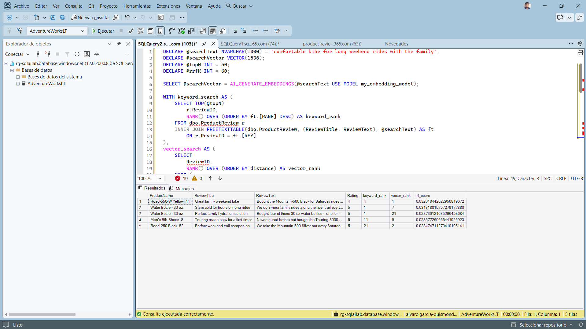

*Figura 32. Híbrida: «Great family weekend bike» primera, con rango 4 de texto y 1 vectorial.*

| Técnica | Primera reseña | Qué aporta |
|---|---|---|
| Texto completo | Stays cold for hours on long rides (botella de agua) | Coincide por palabras sueltas como long y family aunque el tema sea otro |
| Vectorial | Great family weekend bike (distancia 0,3498) | Entiende la intención y devuelve reseñas de bicicletas de paseo |
| Híbrida | Great family weekend bike (RRF 0,0320184) | Premia lo que aparece bien posicionado en ambas listas |

## 13. Resumen de incidencias

| Incidencia | Causa | Solución |
|---|---|---|
| Error de política al crear el proyecto de Foundry | Región y grupo propuestos fuera de las regiones permitidas de la suscripción | Spain Central y grupo rg-sqlailab |
| CustomDomainInUse | El subdominio proj-sqlailab-resource ya figuraba como usado | Proyecto proj-sqlailab-agql |
| gpt-5.4-mini no disponible | Sin cuota en Azure for Students | Omitido, no se usa en esta práctica |
| Errores 40632, 15581 y 46516 | Contraseña de ejemplo sin sustituir y GO incompleto | Contraseña compleja y GO correcto |
| Error 15530 | La credencial ya existía al repetir el bloque | Comprobar con la consulta de verificación |
| PopulateStatus 1 | El índice de texto completo seguía poblándose | Esperar y repetir la consulta |
| Error 42274 en cuatro consultas | TOP_N no se admite con la versión nueva del índice vectorial | SELECT TOP (N) WITH APPROXIMATE |

## 14. Observaciones

Los nombres de producto que salen junto a las reseñas no siempre cuadran con el texto. La reseña «Great family weekend bike» habla de una Mountain-500 Black y aparece asociada a una Road-550-W Yellow, y reseñas de luces salen sobre cuadros de bicicleta. Mi explicación es que el script de reseñas usa identificadores de producto de la AdventureWorks original y la versión LT numera sus productos de otra forma. No afecta al funcionamiento de las búsquedas, pero sí al resultado: como el embedding incluye el nombre del producto, algunas distancias vectoriales se alejan del texto de la reseña.

No eliminé los recursos de Azure al terminar. El propio laboratorio avisa de que se reutilizan en los laboratorios 9, 10 y 11.

## 15. Scripts incluidos

La carpeta `sql/` contiene los scripts en el orden en que los ejecuté.

| Archivo | Contenido |
|---|---|
| 00-product-reviews-insert.sql | Crea dbo.ProductReview e inserta las 140 reseñas |
| 01-credencial-modelo.sql | Clave maestra, credencial y modelo externo |
| 02-verificacion-objetos.sql | Comprobación de los tres objetos |
| 03-vector-embeddings-indice.sql | Columna vectorial, embeddings e índice DiskANN |
| 04-fulltext.sql | Catálogo e índice de texto completo |
| 05-busquedas-fulltext.sql | CONTAINS, FREETEXT, CONTAINSTABLE y prefijo |
| 06-busquedas-vectoriales.sql | VECTOR_DISTANCE, VECTOR_SEARCH y VECTORPROPERTY |
| 07-busqueda-hibrida-rrf.sql | Búsqueda híbrida con RRF |
| 08-comparativa.sql | Texto completo, vectorial e híbrida con la misma pregunta |
